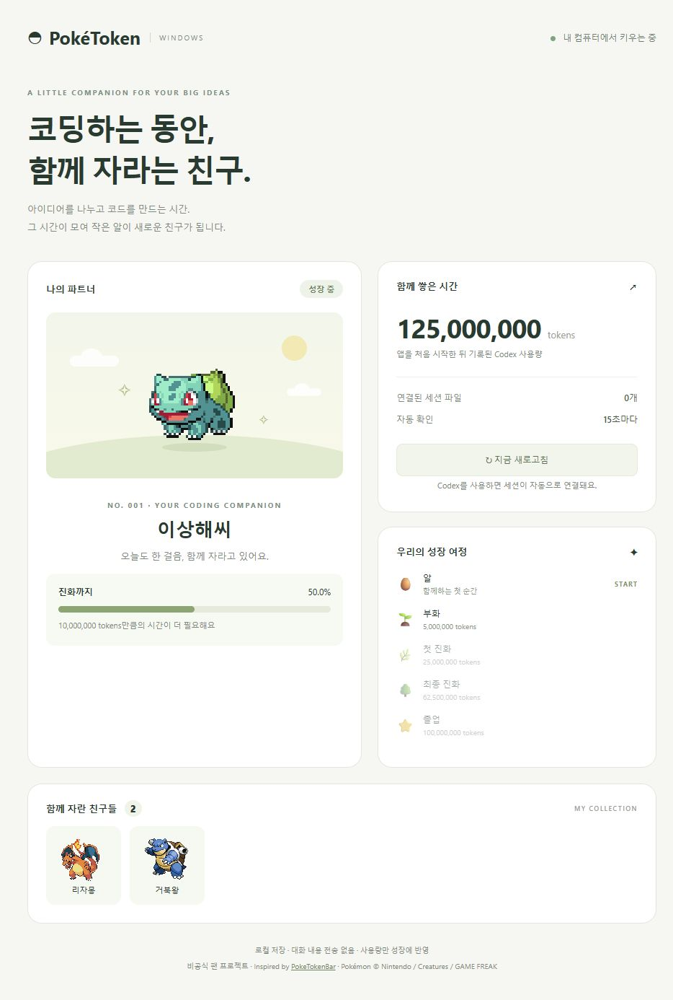
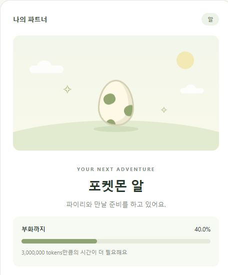
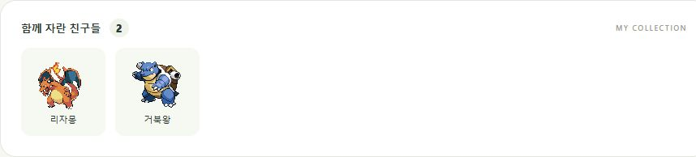

# PokéToken Windows

[English](README.md)

Codex로 코딩하는 동안 알이 부화하고 포켓몬이 진화하는 **Windows용 로컬 동반자 앱**입니다.

이 프로젝트는 [chattymin/PokeTokenBar](https://github.com/chattymin/PokeTokenBar)의 아이디어에서 영감을 받아 별도로 구현한 비공식 Windows MVP입니다. 원본 앱의 Windows 포트나 공식 배포판이 아니며, 원본 소스 코드를 포함하지 않습니다.

## 어떤 앱인가요?

Windows에서 Codex를 쓰는 동안 포켓몬을 키우는 로컬 동반자 앱입니다. 코딩 작업에서 새로 기록되는 입력·출력 토큰을 읽어 알 부화와 진화에 반영합니다. 브라우저 화면에서 파트너, 다음 성장까지의 진행률, 사용량과 컬렉션을 한 번에 확인할 수 있습니다.

별도 게임 플레이나 추가 AI 요청 없이 평소 하던 작업을 이어가면 됩니다.

 실제 앱에 합성 샘플 데이터를 넣어 촬영한 화면입니다.

## 이렇게 키워요

1. 🥚 앱을 실행해 기존 Codex 기록을 기준점으로 잡습니다.
2. 💻 Codex로 평소처럼 작업하면 새 토큰이 15초마다 반영됩니다.
3. 🌱 알이 부화하고 포켓몬이 두 번 진화합니다.
4. 🎓 졸업한 친구는 컬렉션에 남고 새 알을 만납니다.

현재 이상해씨 → 파이리 → 꼬부기 계열을 차례로 키울 수 있습니다.

## 화면 둘러보기

### 🥚 알에서 시작하는 성장

성장 카드에서 부화 또는 다음 진화까지의 진행률과 남은 토큰을 확인합니다. 기존 로그는 첫 실행의 기준점으로만 쓰므로 지난 사용량으로 알이 즉시 부화하지 않습니다.

### 📊 한눈에 확인하는 사용량

대시보드에 앱 시작 이후 기록된 전체 토큰, 연결된 세션 파일 수, 성장 단계별 목표가 표시됩니다. **↻ 지금 새로고침** 버튼으로 바로 확인할 수도 있습니다.

### 🎓 함께 자란 친구들의 컬렉션

졸업한 최종 진화형은 컬렉션에 남습니다. 다음 알을 시작해도 전체 실제 사용량은 유지됩니다.

*스크린샷은 기능 소개용 합성 데이터이며 개인 세션 기록을 포함하지 않습니다.*

## 실행

1. Windows 10/11에 [Node.js LTS](https://nodejs.org/)를 설치합니다. Node.js 22 이상이 필요합니다.
2. 이 저장소를 ZIP으로 내려받고 **압축을 풉니다**. 쓰기 가능한 폴더에 두세요.
3. `Start-PokeToken.cmd`를 더블클릭합니다.
4. 브라우저에서 `http://127.0.0.1:32145`가 열립니다. Codex를 사용하면서 친구를 키워보세요.

추가 패키지 설치, API 키, 유료 API 호출은 필요하지 않습니다. 개발자 실행은 `npm start`, 검증은 `npm test`입니다.

창을 닫아도 로컬 수집기는 실행 중입니다. PC를 다시 시작하면 종료되고, 다시 실행 파일을 열면 이어서 키울 수 있습니다. 수동 종료하려면 `Stop-PokeToken.ps1`을 PowerShell에서 실행하세요. 자동 시작 등록은 하지 않습니다.

## 성장 규칙

| 누적 토큰 | 변화 |
| --- | --- |
| 0 | 이상해씨의 알로 시작 |
| 5,000,000 | 부화 |
| 25,000,000 | 첫 진화 |
| 62,500,000 | 최종 진화 |
| 100,000,000 | 졸업 버튼 활성화 |

졸업한 친구는 컬렉션에 남습니다. 새 알은 이상해씨 → 파이리 → 꼬부기 순으로 돌아갑니다. 졸업할 때 현재 육성 토큰은 0으로 돌아가며 초과분은 이월되지 않습니다. 지금까지 함께 쌓은 전체 토큰은 유지됩니다.

앱 첫 실행 때 기존 로그를 기준점으로 잡고, **그 이후 추가되는 토큰**만 성장에 반영합니다. 입력·출력 토큰을 합산하며 캐시된 입력은 입력에 포함된 만큼만 계산합니다. 추론 토큰을 출력에 다시 더하지 않습니다. 가격이나 결제 금액을 계산하는 앱은 아닙니다.

## 데이터와 개인정보

0.1.1에서는 Codex 입력 토큰 규모에 맞춰 성장 기준을 250배 높였습니다. 소요 시간은 사용량에 따라 달라집니다. 업데이트 시 현재 단계와 진행률, 전체 실제 사용량, 컬렉션을 유지합니다. 성장 진행도만 한 번 환산하며 전체 토큰을 추가하지 않습니다. 원래 저장 파일은 `data/save.pre-balance-v2.json`에 보관합니다.

- 기본 읽기 위치: `%USERPROFILE%\.codex\sessions\**\*.jsonl`. `CODEX_HOME`이 있으면 그 안의 `sessions`를 읽습니다.
- Codex의 로컬 `event_msg / token_count` 이벤트를 15초마다 확인합니다. 현재 스키마를 기준으로 구현했으므로 향후 로그 형식 변경에 대응이 필요할 수 있습니다.
- 대화 파일을 로컬에서 읽지만 토큰 이벤트만 처리합니다. 대화 내용, 계정 토큰, 인증 파일은 저장하거나 전송하지 않습니다.
- 앱은 `127.0.0.1`에만 바인딩하며 외부에서 접속할 수 없습니다.
- 스프라이트는 PokeAPI의 GitHub 저장소에서 브라우저로 가져옵니다. 이 요청에는 포켓몬 번호가 포함되며 일반적인 접속 정보가 GitHub에 전달됩니다. 이미지가 로드되지 않아도 성장과 저장은 동작합니다.
- 진행도, 컬렉션, 파일 경로·읽기 위치·토큰 카운터를 앱 폴더의 `data/save.json`에 저장합니다. 직전 저장 파일은 `data/save.json.bak`에 보관합니다. 훼손된 저장 파일은 자동으로 덮어쓰지 않습니다.
- `data/` 전체는 Git에서 제외됩니다. **저장 파일이나 개인 세션 로그를 공개하지 마세요.**

로그가 없는 경우 앱은 연결 대기 상태로 동작합니다. 첫 전체 스캔은 기록량에 따라 시간이 걸릴 수 있습니다. 다른 PC로 옮길 때는 소스만 공유하고 각자 새로 시작하는 것을 권장합니다. 여러 복사본을 동시에 실행하거나 저장 폴더를 공유하지 마세요.

## 현재 범위

알 부화, 두 번의 진화, 졸업, 세 계열의 컬렉션, 로컬 자동 저장, Codex 사용량 연동을 제공합니다. 브라우저에서 열리는 앱이며 바탕화면 위에 떠다니는 캐릭터, 작업표시줄 트레이, 상점, 반짝이, 원본의 649종 도감은 포함하지 않습니다.

로컬 로그 기준이므로 공식 사용량·과금 수치와 다를 수 있습니다. 삭제된 로그는 새 토큰을 만들지 않습니다. 과거 로그를 실행 도중 새로 복사해 넣으면 해당 로그의 토큰이 추가 사용량으로 잡힐 수 있습니다.

## 출처와 라이선스

- 독립 구현 코드: MIT (`LICENSE`).
- 아이디어: [PokeTokenBar — chattymin](https://github.com/chattymin/PokeTokenBar).
- 스프라이트 제공 경로: [PokeAPI/sprites](https://github.com/PokeAPI/sprites). 앱은 스프라이트를 실행 시 가져옵니다. 문서의 포켓몬 이미지는 앱 기능을 설명하기 위한 실행 화면입니다.
- Pokémon 및 관련 캐릭터·상표·그래픽의 권리는 Nintendo / Creatures / GAME FREAK 등 각 권리자에게 있습니다. 코드의 MIT 라이선스는 해당 자산이나 상표에 대한 권리를 부여하지 않습니다.

공식 Pokémon 제품 또는 원본 개발자의 공식 Windows 버전이 아닙니다.