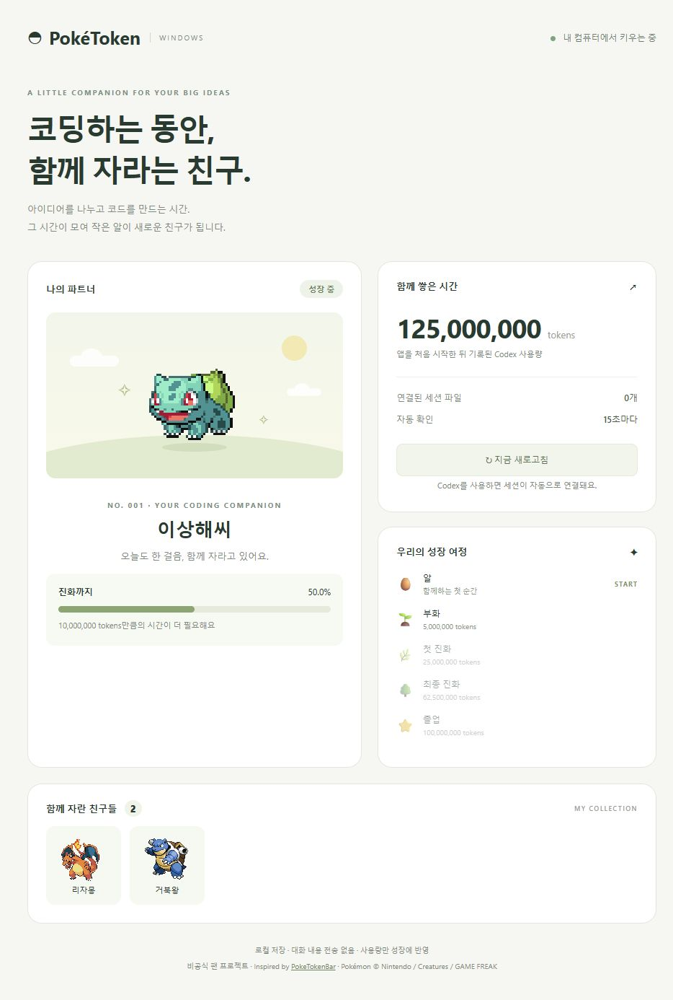
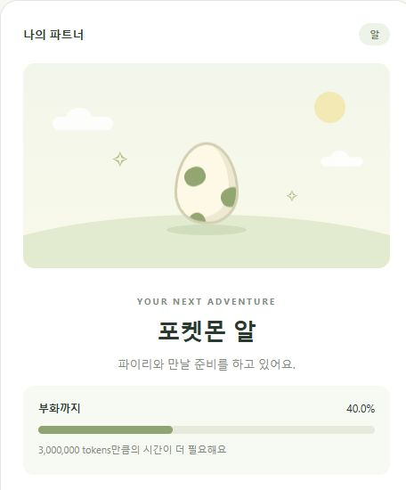
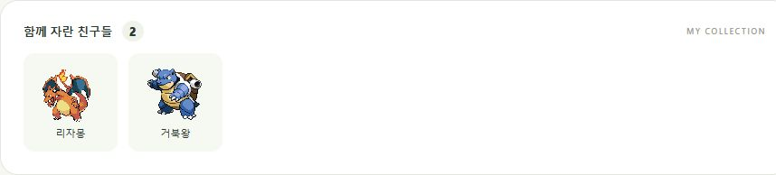

<div align="center">

# PokéToken Windows

**Turn your everyday Codex sessions into a Pokémon companion.**

[](#install)
[](https://nodejs.org/)
[](https://github.com/Ezby/PokeToken-Windows/actions/workflows/test.yml)
[](LICENSE)

**English** · [한국어](README.ko.md)

[**Download for Windows ↓**](https://github.com/Ezby/PokeToken-Windows/archive/refs/heads/main.zip) · [Install](#install) · [How it works](#how-it-works) · [Tour](#tour)

</div>

PokéToken Windows is a **local companion app for people who use Codex on Windows**. It reads token usage from your local Codex sessions and turns that activity into progress: an egg hatches, your Pokémon evolves, and a fully grown companion joins your collection. Open the dashboard in your browser whenever you want to see how your little friend is doing.

Keep working on your own projects. There is no separate game to grind, no API key to enter, and no extra model requests made by this app.

<p align="center">
  
  <br>
  <sub>Actual app UI with sample data. The interface is currently in Korean; setup and feature explanations below are in English.</sub>
</p>

## Why keep a companion?

- **Give your coding sessions a little personality.** Come back to a growing friend after working with Codex.
- **See your progress at a glance.** Your companion, recorded tokens, next milestone, and collection share one dashboard.
- **Keep it simple and local.** No account for this app, no npm dependencies, and automatic saves on your computer.

## How it works

1. 🥚 **Start with an egg.** Launch the app once to establish a baseline from your existing Codex session history.
2. 💻 **Work with Codex as usual.** Newly recorded input and output tokens feed your companion. The dashboard refreshes every 15 seconds.
3. 🌱 **Hatch and evolve.** Your companion moves through its real evolution line as you reach each growth milestone.
4. 🎓 **Graduate and collect.** At the final milestone, choose to graduate your Pokémon. It stays in your collection while a new egg starts the next journey.

The current roster cycles through **Bulbasaur → Charmander → Squirtle**, including both evolutions for each starter.

## Tour

<table>
<tr>
<td width="44%" align="center">

</td>
<td width="56%" valign="middle">
<h3>🥚 A small beginning</h3>
Your egg has a visible progress bar and a remaining-token count. New usage moves it toward hatching; later, the same card follows your Pokémon toward its next evolution. You can check in without interrupting your work.
</td>
</tr>
<tr>
<td colspan="2">
<h3>📊 See the journey, not just a number</h3>
The dashboard shows the total tokens recorded since you first launched the app, connected session-file count, and every milestone on the path to graduation. Use the <b>↻</b> button for a manual refresh. Existing history sets a baseline rather than instantly completing a new companion.
</td>
</tr>
<tr>
<td colspan="2">
<h3>🎓 Keep the friends you have raised</h3>
Graduation adds your final-form Pokémon to the collection below the dashboard. Your lifetime token total stays with you as a new egg begins.
<br><br>

</td>
</tr>
</table>

*Screenshots show the production UI using synthetic sample saves. They contain no personal session logs.*

## Install

1. Install [Node.js LTS](https://nodejs.org/) on Windows 10 or 11. **Node.js 22 or newer** is required.
2. [Download the ZIP](https://github.com/Ezby/PokeToken-Windows/archive/refs/heads/main.zip) and **extract it** to a writable folder.
3. Double-click **`Start-PokeToken.cmd`**.
4. Your browser opens **http://127.0.0.1:32145**. Use Codex and watch your companion grow.

No npm dependencies, API keys, or paid API requests are required. The app interface is currently in Korean.

The collector keeps running when you close the browser. Restarting Windows stops it; launching the app again resumes your progress. To stop it manually, run `Stop-PokeToken.ps1` in PowerShell. The app does not register itself to start at login.

### Supported in this release

This is a browser-based Windows companion for **local Codex session logs**. It does not currently include a floating desktop pet, system tray integration, other coding providers, shops, shiny variants, or the original project's full Pokédex. An independent implementation inspired by [chattymin/PokeTokenBar](https://github.com/chattymin/PokeTokenBar), it is not an official Windows port.

## Growth

| Tokens earned for the current companion | Milestone |
| --- | --- |
| 0 | Start with a Bulbasaur egg |
| 5,000,000 | Hatch |
| 25,000,000 | First evolution |
| 62,500,000 | Final evolution |
| 100,000,000 | Graduation available |

Click **졸업하고 새 알 만나기 →** to graduate your companion and receive a new egg. Graduates remain in your collection. Eggs cycle through Bulbasaur → Charmander → Squirtle.

Graduation resets the current companion's growth to zero; excess growth does not carry over. Your lifetime token total is retained.

Version 0.1.1 increases growth thresholds by 250× to better suit Codex input-token volumes. Growth depends on usage, so these thresholds do not guarantee a fixed duration. Upgrading preserves your current stage and its percentage, lifetime usage, and collection. Progress is rescaled once; this does not add tokens to lifetime usage. The original save is backed up to `data/save.pre-balance-v2.json`.

On first launch, existing session history establishes a baseline. **Only newly recorded tokens count toward growth.** Input and output tokens are counted. Cached input counts only as already included in input usage; reasoning tokens are not added again on top of output usage. The app does not calculate charges.

## Privacy and saves

- Default log location: `%USERPROFILE%\.codex\sessions\**\*.jsonl`. With `CODEX_HOME` set, its `sessions` subdirectory is used instead.
- The collector reads local `event_msg / token_count` events. Conversation text, account credentials, and authentication files are not saved or transmitted.
- The server listens on **127.0.0.1 only**, not your network interfaces.
- Sprites load directly in your browser from [PokeAPI/sprites](https://github.com/PokeAPI/sprites). GitHub receives ordinary image-request information and the Pokémon number. Growth and saving work without images.
- Progress, collection entries, log paths, read offsets, and counters are stored in `data/save.json`. The previous save is kept as `data/save.json.bak`.
- An unreadable save is preserved. With the collector stopped, restore a valid backup by copying `save.json.bak` to `save.json`.
- `data/` is ignored by Git. Keep saves and personal session logs private.

Use a writable folder and run only one copy at a time.

## Troubleshooting

**No connected sessions:** Use Codex locally and check that session logs exist in the expected directory. Set a custom `CODEX_HOME` before launching if needed. Cloud-only activity without local logs is not tracked.

**Slow first launch:** The initial scan reads existing history to establish a baseline. Later scans read appended records.

**Usage differs from official totals:** Growth uses local session events, not billing or quota APIs. Log-format changes may require updates. Copying old logs into the directory while the app runs can count those records as newly discovered usage.

**Port conflict:** The default port is 32145. Stop the conflicting app, or launch `server.mjs` directly with `POKETOKEN_PORT` set and open the matching URL. The double-click launcher and stop script use the default port.

## Development and contributions

```sh
npm start
npm test
```

No dependency installation is needed. Tests cover growth stages, token parsing, incremental reads, partial writes, repeated events, counter resets, first-launch baselines, graduation, save restoration, and origin checks. GitHub Actions runs tests on Windows with Node.js 22.

| Environment variable | Purpose |
| --- | --- |
| `CODEX_HOME` | Codex directory containing `sessions/` |
| `POKETOKEN_DATA_DIR` | Override the save directory |
| `POKETOKEN_PORT` | Override the port when launching the server directly |

Contributions and bug reports are welcome. Use synthetic token events in tests and remove personal paths, conversations, and credentials from reports.

## Credits and license

- Inspiration: [PokeTokenBar by chattymin](https://github.com/chattymin/PokeTokenBar).
- Sprite delivery: [PokeAPI/sprites](https://github.com/PokeAPI/sprites). The app requests sprites at runtime. Documentation screenshots show Pokémon imagery only to illustrate the app's functionality.
- Independent application code: [MIT](LICENSE).
- Pokémon characters, names, trademarks, and graphics belong to their respective owners, including Nintendo, Creatures, and GAME FREAK. The code license does not grant rights to those assets or trademarks.

Not affiliated with or endorsed by those rights holders or the original PokeTokenBar developer.